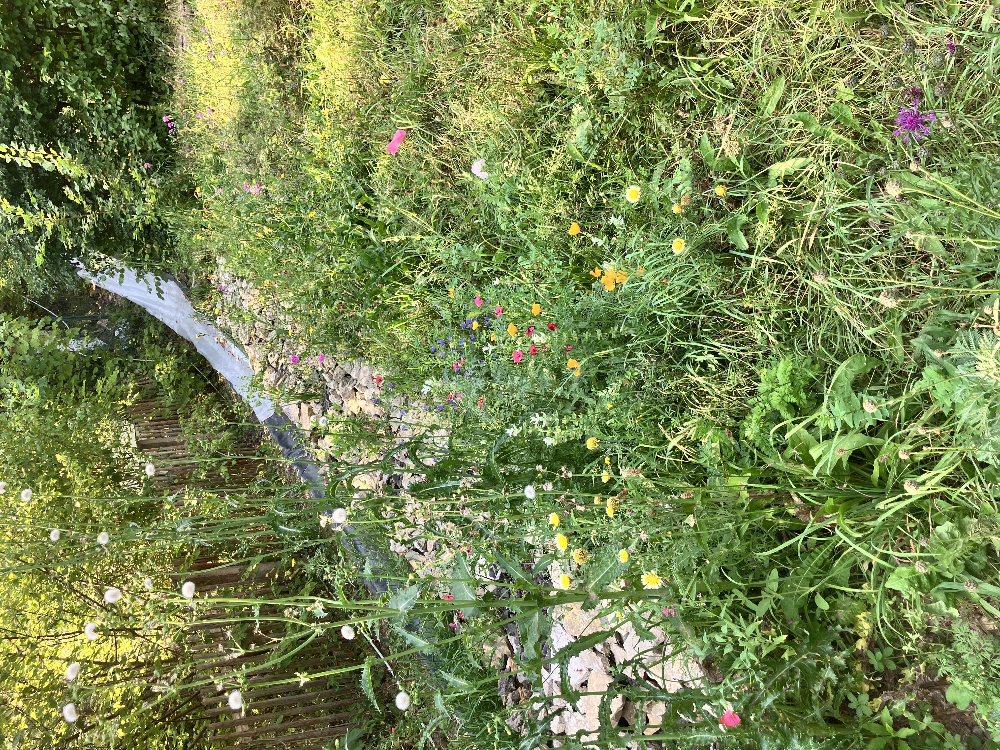
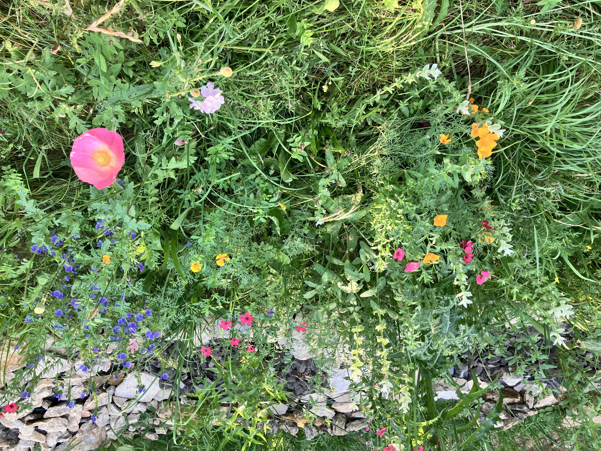
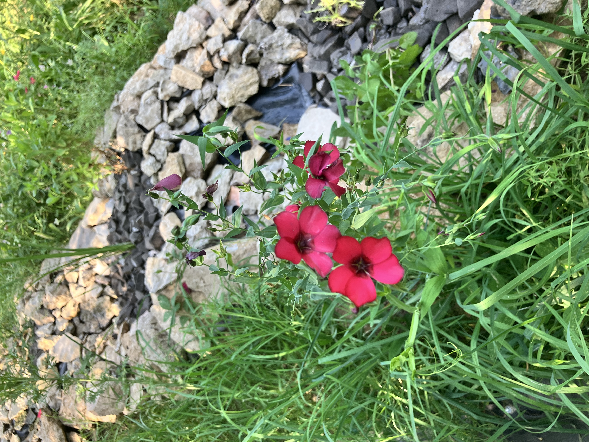
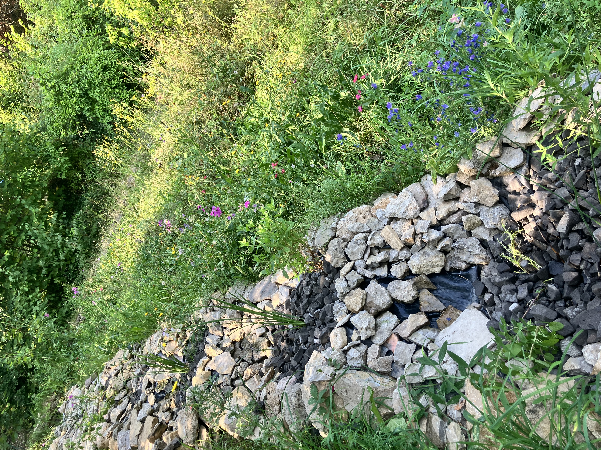
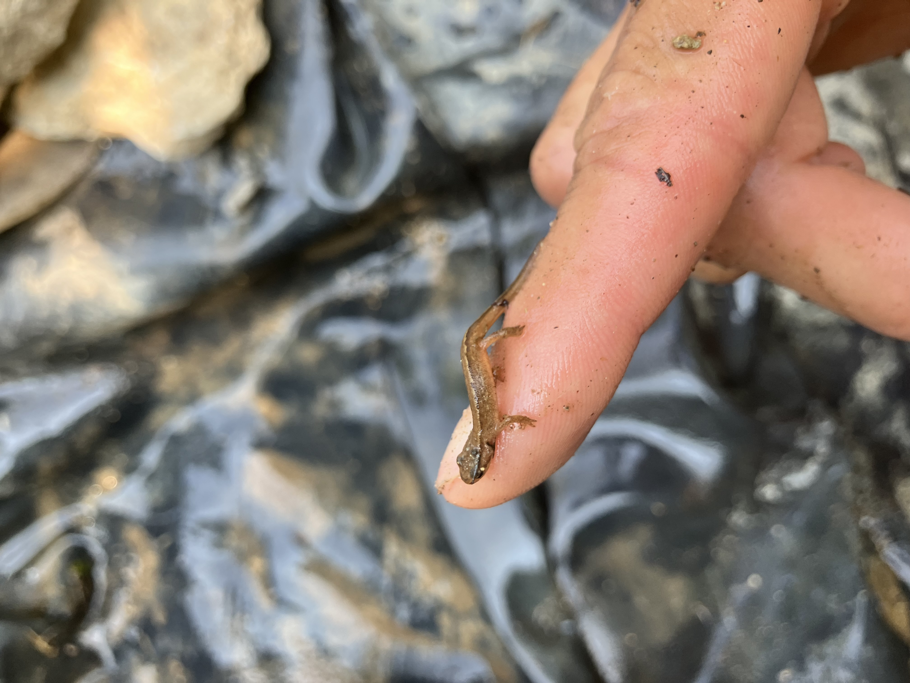

<!--

  

    
		<a href="../index">Foyer</a>
	
  

  <nav class="garden-nav">
    <a href="Rundgang">Rundgang</a>
    <a href="buchung">Buchung</a>
    <a href="Gästehandbuch">Benutzerhandbuch</a>
    <a href="mailto:C.krich@gmx.de?subject=Anfrage%20Friend%27s%20Retreat"  class="garden-nav__kontakt">Kontakt</a>
  </nav>

-->

<h1>Friend's Retreat in Jena</h1>

  Naturbelassener Garten am Rande von Jena. Südhanglage, Vielfältige Wanderwege, Rad und Mountainbikestrecken in der Umgebung. Schwimmteich und 30 m Rutsche. Er befindet sich am Südhang des schönen, bewaldeten Tals im Münchenrodaer Grund. 

<section class="vermietung-features">
  <h2>Ausstattung</h2>
  

    
 <svg class="feature-icon" aria-hidden="true" xmlns="http://www.w3.org/2000/svg" width="24" height="24" viewBox="0 0 24 24" fill="none" stroke="currentColor" stroke-width="2" stroke-linecap="round" stroke-linejoin="round" class="lucide lucide-castle"><path d="M10 5V3"/><path d="M14 5V3"/><path d="M15 21v-3a3 3 0 0 0-6 0v3"/><path d="M18 3v8"/><path d="M18 5H6"/><path d="M22 11H2"/><path d="M22 9v10a2 2 0 0 1-2 2H4a2 2 0 0 1-2-2V9"/><path d="M6 3v8"/></svg>Garten, 1.600 m², Südhang, teils terrassiert 

	
 <svg class="feature-icon" aria-hidden="true" xmlns="http://www.w3.org/2000/svg" width="24" height="24" viewBox="0 0 24 24" fill="none" stroke="currentColor" stroke-width="2" stroke-linecap="round" stroke-linejoin="round" class="lucide lucide-bed-double"><path d="M2 20v-8a2 2 0 0 1 2-2h16a2 2 0 0 1 2 2v8"/><path d="M4 10V6a2 2 0 0 1 2-2h12a2 2 0 0 1 2 2v4"/><path d="M12 4v6"/><path d="M2 18h20"/></svg> Tinyhouse (19qm, 1 Bett), Wohnanhänger (2 Liegeflächen), Heulager (1 Bett), 2-3 Zeltflächen Bett=2m × 1,4 m 

	
 <svg class="feature-icon" aria-hidden="true" xmlns="http://www.w3.org/2000/svg" width="24" height="24" viewBox="0 0 24 24" fill="none" stroke="currentColor" stroke-width="2" stroke-linecap="round" stroke-linejoin="round" class="lucide lucide-users"><path d="M16 21v-2a4 4 0 0 0-4-4H6a4 4 0 0 0-4 4v2"/><path d="M16 3.128a4 4 0 0 1 0 7.744"/><path d="M22 21v-2a4 4 0 0 0-3-3.87"/><circle cx="9" cy="7" r="4"/></svg> ca. 13 Gäste über längeren Zeitraum möglich 

	
 <svg class="feature-icon" aria-hidden="true" xmlns="http://www.w3.org/2000/svg" width="24" height="24" viewBox="0 0 24 24" fill="none" stroke="currentColor" stroke-width="2" stroke-linecap="round" stroke-linejoin="round" class="lucide lucide-waves-horizontal"><path d="M2 12q2.5 2 5 0t5 0 5 0 5 0"/><path d="M2 19q2.5 2 5 0t5 0 5 0 5 0"/><path d="M2 5q2.5 2 5 0t5 0 5 0 5 0"/></svg>Schwimmteich mit Rutsche 

    
 <svg class="feature-icon" aria-hidden="true"  xmlns="http://www.w3.org/2000/svg" width="24" height="24" viewBox="0 0 24 24" fill="none" stroke="currentColor" stroke-width="2" stroke-linecap="round" stroke-linejoin="round" class="lucide lucide-sun"><circle cx="12" cy="12" r="4"/><path d="M12 2v2"/><path d="M12 20v2"/><path d="m4.93 4.93 1.41 1.41"/><path d="m17.66 17.66 1.41 1.41"/><path d="M2 12h2"/><path d="M20 12h2"/><path d="m6.34 17.66-1.41 1.41"/><path d="m19.07 4.93-1.41 1.41"/></svg>Terrasse mit Couches (auch zum Schlafen), Wiese 

    
 <svg class="feature-icon" aria-hidden="true"  xmlns="http://www.w3.org/2000/svg" width="24" height="24" viewBox="0 0 24 24" fill="none" stroke="currentColor" stroke-width="2" stroke-linecap="round" stroke-linejoin="round" class="lucide lucide-cloud-hail"><path d="M4 14.899A7 7 0 1 1 15.71 8h1.79a4.5 4.5 0 0 1 2.5 8.242"/><path d="M16 14v2"/><path d="M8 14v2"/><path d="M16 20h.01"/><path d="M8 20h.01"/><path d="M12 16v2"/><path d="M12 22h.01"/></svg>Balkon, Pavillion 

	
 <svg class="feature-icon" aria-hidden="true" xmlns="http://www.w3.org/2000/svg" width="24" height="24" viewBox="0 0 24 24" fill="none" stroke="currentColor" stroke-width="2" stroke-linecap="round" stroke-linejoin="round" class="lucide lucide-flame-kindling"><path d="M12 2c1 3 2.5 3.5 3.5 4.5A5 5 0 0 1 17 10a5 5 0 1 1-10 0c0-.3 0-.6.1-.9a2 2 0 1 0 3.3-2C8 4.5 11 2 12 2Z"/><path d="m5 22 14-4"/><path d="m5 18 14 4"/></svg>Grill und Feuerstelle 

	
 <svg class="feature-icon" aria-hidden="true" xmlns="http://www.w3.org/2000/svg" width="24" height="24" viewBox="0 0 24 24" fill="none" stroke="currentColor" stroke-width="2" stroke-linecap="round" stroke-linejoin="round" class="lucide lucide-cooking-pot"><path d="M2 12h20"/><path d="M20 12v8a2 2 0 0 1-2 2H6a2 2 0 0 1-2-2v-8"/><path d="m4 8 16-4"/><path d="m8.86 6.78-.45-1.81a2 2 0 0 1 1.45-2.43l1.94-.48a2 2 0 0 1 2.43 1.46l.45 1.8"/></svg>Küche draußen und drinnen 

	
 <svg class="feature-icon" aria-hidden="true" xmlns="http://www.w3.org/2000/svg" width="24" height="24" viewBox="0 0 24 24" fill="none" stroke="currentColor" stroke-width="2" stroke-linecap="round" stroke-linejoin="round" class="lucide lucide-shower-head"><path d="m4 4 2.5 2.5"/><path d="M13.5 6.5a4.95 4.95 0 0 0-7 7"/><path d="M15 5 5 15"/><path d="M14 17v.01"/><path d="M10 16v.01"/><path d="M13 13v.01"/><path d="M16 10v.01"/><path d="M11 20v.01"/><path d="M17 14v.01"/><path d="M20 11v.01"/></svg>Gartendusche/Wasserschlauch 

	
 <svg class="feature-icon" aria-hidden="true" xmlns="http://www.w3.org/2000/svg" width="24" height="24" viewBox="0 0 24 24" fill="none" stroke="currentColor" stroke-width="2" stroke-linecap="round" stroke-linejoin="round" class="lucide lucide-thermometer-snowflake"><path d="m10 20-1.25-2.5L6 18"/><path d="M10 4 8.75 6.5 6 6"/><path d="M10.585 15H10"/><path d="M2 12h6.5L10 9"/><path d="M20 14.54a4 4 0 1 1-4 0V4a2 2 0 0 1 4 0z"/><path d="m4 10 1.5 2L4 14"/><path d="m7 21 3-6-1.5-3"/><path d="m7 3 3 6h2"/></svg>Holzofen nur im Häusschen 

	
 <svg class="feature-icon" aria-hidden="true" xmlns="http://www.w3.org/2000/svg" width="24" height="24" viewBox="0 0 24 24" fill="none" stroke="currentColor" stroke-width="2" stroke-linecap="round" stroke-linejoin="round" class="lucide lucide-map"><path d="M14.106 5.553a2 2 0 0 0 1.788 0l3.659-1.83A1 1 0 0 1 21 4.619v12.764a1 1 0 0 1-.553.894l-4.553 2.277a2 2 0 0 1-1.788 0l-4.212-2.106a2 2 0 0 0-1.788 0l-3.659 1.83A1 1 0 0 1 3 19.381V6.618a1 1 0 0 1 .553-.894l4.553-2.277a2 2 0 0 1 1.788 0z"/><path d="M15 5.764v15"/><path d="M9 3.236v15"/></svg>Wanderwege, Wald, Naturschutzgebiete, Hügel, Mountainbikestrecken, Steinbruch, Restaurants, Jena Stadt (3km) 

	
 <svg class="feature-icon" aria-hidden="true" xmlns="http://www.w3.org/2000/svg" width="24" height="24" viewBox="0 0 24 24" fill="none" stroke="currentColor" stroke-width="2" stroke-linecap="round" stroke-linejoin="round" class="lucide lucide-thermometer-snowflake"><path d="m10 20-1.25-2.5L6 18"/><path d="M10 4 8.75 6.5 6 6"/><path d="M10.585 15H10"/><path d="M2 12h6.5L10 9"/><path d="M20 14.54a4 4 0 1 1-4 0V4a2 2 0 0 1 4 0z"/><path d="m4 10 1.5 2L4 14"/><path d="m7 21 3-6-1.5-3"/><path d="m7 3 3 6h2"/></svg>Holzofen nur im Häusschen 

	
 <svg class="feature-icon" aria-hidden="true" xmlns="http://www.w3.org/2000/svg" width="24" height="24" viewBox="0 0 24 24" fill="none" stroke="currentColor" stroke-width="2" stroke-linecap="round" stroke-linejoin="round" class="lucide lucide-dog"><path d="M11.25 16.25h1.5L12 17z"/><path d="M16 14v.5"/><path d="M4.42 11.247A13.152 13.152 0 0 0 4 14.556C4 18.728 7.582 21 12 21s8-2.272 8-6.444a11.702 11.702 0 0 0-.493-3.309"/><path d="M8 14v.5"/><path d="M8.5 8.5c-.384 1.05-1.083 2.028-2.344 2.5-1.931.722-3.576-.297-3.656-1-.113-.994 1.177-6.53 4-7 1.923-.321 3.651.845 3.651 2.235A7.497 7.497 0 0 1 14 5.277c0-1.39 1.844-2.598 3.767-2.277 2.823.47 4.113 6.006 4 7-.08.703-1.725 1.722-3.656 1-1.261-.472-1.855-1.45-2.239-2.5"/></svg>Haustiere sind erlaubt 

  

</section>

<section class="vermietung-gallery">
  <h2>Impressionen</h2>
  <!--
  

    
    
    
    
    
    
    
    
  

  -->
  

  

    
    
  

  

    
    
    
  

  

    
  

  

    
  

</section>

<section class="vermietung-reviews">
  <h2>Bewertungen</h2>
  

    <a href="https://www.airbnb.de/rooms/1144950732118797811?guests=1&adults=1&s=66&source=embed_widget">Auf Airbnb ansehen</a>
    <a href="https://www.airbnb.de/rooms/1144950732118797811?guests=1&adults=1&s=66&source=embed_widget" rel="nofollow">Tiny House · Jena · ★4,78 · 3 Schlafzimmer · 4 Betten · 1 Badezimmer</a>
  

</section>

<section class="vermietung-pricing">
  <h2>Preise</h2>
  <table>
    <tr><td>Mai, Juni, Juli, August</td><td> 75 € / Nacht bis 2 Personen</td></tr>
    <tr><td>übrige Zeit</td><td>50 € / Nacht bis 2 Personen</td></tr>
    <tr><td>pro Person ab 3. Gast</td><td> 13 €</td></tr>
    <tr><td>Endreinigung</td><td> 32 €</td></tr>
    <tr><td>Feuerholz</td><td> nach Verbrauch, 5€/12dm </td></tr>
  </table>
</section>

  <a href="mailto:C.krich@gmx.de?subject=Anfrage%20Friend%27s%20Retreat" class="cta-kontakt">Host kontaktieren</a>

